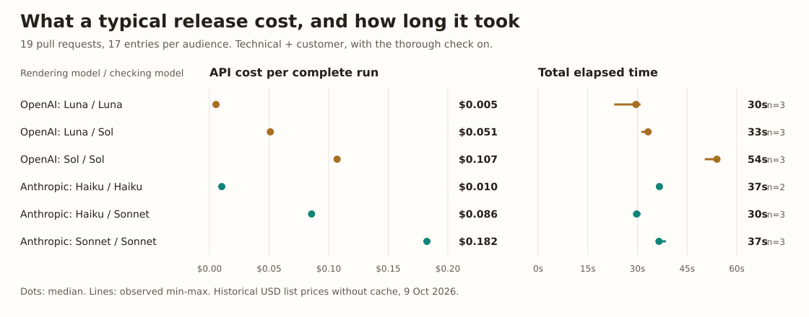
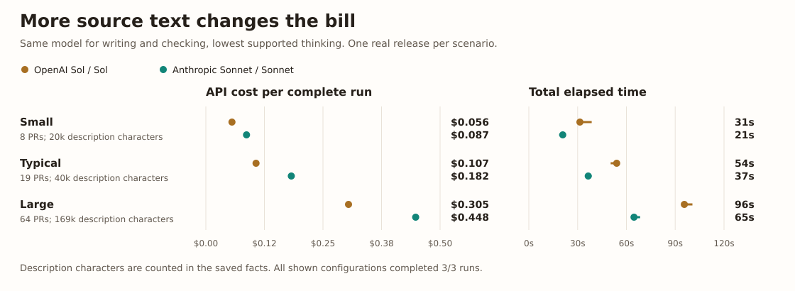
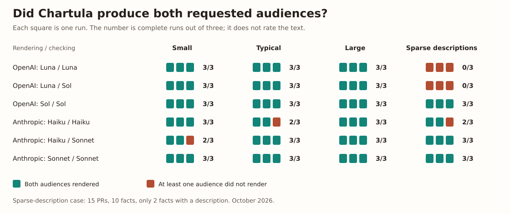
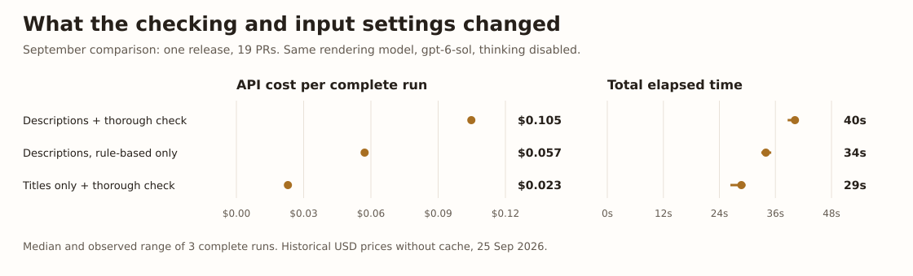

# What to expect from Chartula

Chartula turns the merged pull requests of a release into notes for developers and people who use your product.
It chooses the changes and their structure before asking a model to write, then checks the resulting statements against those pull requests.
You get files to review and a draft release to publish, with the statements the checks flag listed in the terminal.

For the six configurations shown below, a 19-pull-request release had a median cost of **$0.005 to $0.182** and a median duration of **30 to 54 seconds** across complete runs.
Those are measured examples at historical API prices; the text still needs your review.

## One change, written for two readers

Chartula's own release notes provide a small example.
[Pull request #359](https://github.com/goldbarth/chartula/pull/359) fixed a progress step that said "done" when an audience had failed to render, and added the reason release notes were skipped.
One October run wrote the following entries from that change.

**For developers, in `CHANGELOG.md`:**

> Mark the step of an audience that did not render as failed, and list the release notes under `Skipped` with the reason when a publishing run has no technical rendering. ([#359](https://github.com/goldbarth/chartula/pull/359))

**For users, in `release-<tag>.md`:**

> When one audience failed to render, its step was still shown as done, directly above the line reporting the failure, and a publishing run said nothing about the release notes.
> The step is now marked as failed, and the release notes are listed under Skipped with the reason: the technical rendering failed, or `--audience` left it out.
> You can now trust the step marks and the summary to agree, and see why nothing was published.

These are unedited excerpts generated by `claude-sonnet-5-5`.
[Outputs](outputs.md) shows the complete file formats and the optional product-management audience.

## What does a release cost, and how long does it take?

Chartula has no subscription or hosted service to pay for.
With a hosted model, you pay the provider for writing and for the optional model-based thorough check; the rule-based check makes no model call.
Local models use your hardware instead of a paid API.

The release below had 19 pull requests and produced 17 entries in each of the technical and customer texts.
Every configuration had the thorough check on.
The labels name the model that wrote the text first and the model that checked it second.

*Three runs per configuration, October 9, 2026.
Cost and time include both audiences; only complete runs enter the median.
Haiku / Haiku completed two of its three runs, so its median has two observations.*

When Luna or Haiku wrote and Sol or Sonnet checked, the check accounted for about **94% of the mean API cost** on this release.
The checker can therefore account for most of the bill, even with a cheap writer.
Its accuracy was not evaluated.

## Release size and source material matter

Chartula reads descriptions as well as titles by default.
The amount of source text matters alongside the number of changes.

*Three complete runs per configuration and release.
Description sizes are counted in the saved facts.
Each scenario is one real release, so the chart describes these examples rather than a universal price per pull request.*

The large release had 64 pull requests but 28 changes reached each rendering; the remaining facts were documentation changes.
You can see the facts and prompt sizes for **your** release with `chartula preview`, before any model call is made.
[Costs and checks](costs-and-checks.md#before-a-run-the-size-preview-shows) explains how to read that preview and estimate the bill.

## Does every run produce both texts?

In the October comparison, **74 of 84 runs produced both requested audiences**.
The other ten finished their model calls but Chartula refused at least one audience's answer, for example when it left out a required change.
Those attempts still spent tokens.

*The chart shows the six combinations measured on all four scenarios.
The 84-run total also includes two premium-writer combinations measured on the typical and sparse-description releases.*

The sparse-description release had 15 pull requests, but only two of its ten facts had descriptions.
A short release can still be difficult to render, although these runs do not isolate missing descriptions as the cause.

Chartula refuses an answer that omits, duplicates or adds a change instead of writing that answer as release notes.
That protects the set of changes, while a completed run can still contain statements that need editing.
[Writing pull requests](writing-pull-requests.md) shows what useful source material looks like, and [Troubleshooting](troubleshooting.md#the-answer-does-not-match-the-facts) explains a refused rendering.

## What can I change about the cost?

A separate September comparison changed one setting at a time on the same 19-PR release.
It used `gpt-6-sol` without thinking for writing, and the same model for the thorough check when enabled.

Turning the thorough check off removes a model call per audience and leaves the rule-based check.
Only the thorough check reported flags in this comparison; whether they were justified was not evaluated.

Using titles alone sent less information to both the writer and the checker.
The lower bill is measured; what the texts lost in useful detail was not evaluated.

On this September release, `gpt-6-sol` with high thinking took **170 seconds** instead of **40**, and cost **$0.170** instead of **$0.105**.
Whether that extra work improved the text was not measured.
[Providers](providers.md#thinking) and [Configuration](configuration.md) describe these settings.

## What do I still need to review?

Chartula checks statements against your pull requests, not against the implementation.
A wrong description can therefore produce a wrong entry even if the check accepts it.
A flag points to something to read; it is not a confirmed error, and no flags is not proof that the text is ready to publish.

The comparisons measured cost, time, completion and checker reports.
They did not establish a text-quality ranking or how much editing a release needs.
Read the generated files and the flags before publishing the draft.
The [README example](../README.md#what-it-looks-like) shows a real claim the thorough check flagged and why.

## Try it on your release

Start with [Getting started](getting-started.md): check the setup with `doctor`, inspect the release with `preview`, then use `generate --no-publish` to write the files locally.
That gives you your own texts, flags, token counts and elapsed time before you publish anything.

Measurements, model settings and data

The October measurements used Chartula `0.1.0-preview.5+541842d`, one prompt, `title-and-description`, technical and customer audiences, and the thorough check on.
Each configuration ran three times against each selected release.
Models used their lowest accepted thinking setting, so the settings differ between models.

| Chart label | Writing model | Writing thinking | Checking model | Checking thinking |
| --- | --- | --- | --- | --- |
| Luna / Luna | `gpt-6-luna` | disabled | `gpt-6-luna` | disabled |
| Luna / Sol | `gpt-6-luna` | disabled | `gpt-6.1-sol` | low |
| Sol / Sol | `gpt-6.1-sol` | low | `gpt-6.1-sol` | low |
| Haiku / Haiku | `claude-haiku-5-5` | disabled | `claude-haiku-5-5` | disabled |
| Haiku / Sonnet | `claude-haiku-5-5` | disabled | `claude-sonnet-5-5` | low |
| Sonnet / Sonnet | `claude-sonnet-5-5` | low | `claude-sonnet-5-5` | low |

The two additional premium configurations used `gpt-6-astra` writing with `gpt-6.1-sol` checking, and `claude-opus-5-5` writing with `claude-sonnet-5-5` checking, all at low thinking.
They were measured only on the typical and sparse-description releases and are included in the linked data.

| Scenario | Pull requests | Facts | Facts with a description | Complete runs / all runs |
| --- | ---: | ---: | ---: | ---: |
| Small | 8 | 7 | 7 | 17/18 |
| Typical | 19 | 18 | 18 | 22/24 |
| Large | 64 | 63 | 63 | 18/18 |
| Sparse descriptions | 15 | 10 | 2 | 17/24 |

The September measurements used Chartula `0.1.0-preview.3+7620e6d` and an earlier prompt.
The three settings shown here each had three complete runs.
They are a separate comparison and are not pooled with October.

All chart prices are USD at the historical list rates, with input charged in full to keep cache order from deciding the comparison.
The data also keeps calculated costs after cache; neither calculation is an invoice verification or a quote for current pricing.
Medians and observed min-max ranges describe repeated runs on these releases, not confidence intervals or a guarantee for another repository.
Each configuration generated new text, so these runs do not isolate the checker alone.

Download the [October run measurements](assets/expectations/october-runs.csv), [October summaries](assets/expectations/october-summary.csv), [September run measurements](assets/expectations/september-runs.csv) and [September summaries](assets/expectations/september-summary.csv).
[Chart provenance and reproduction](assets/expectations/README.md) records the source files, versions and checksums.
The complete evaluation material lives in [chartula-evals](https://github.com/goldbarth/chartula-evals).

